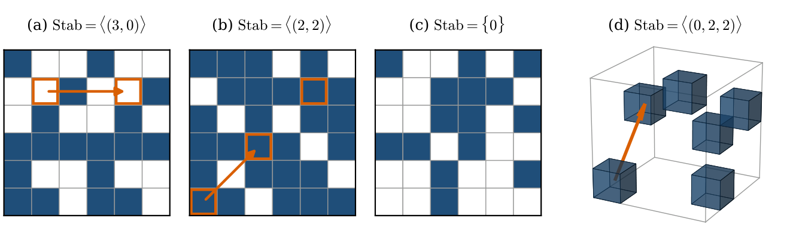
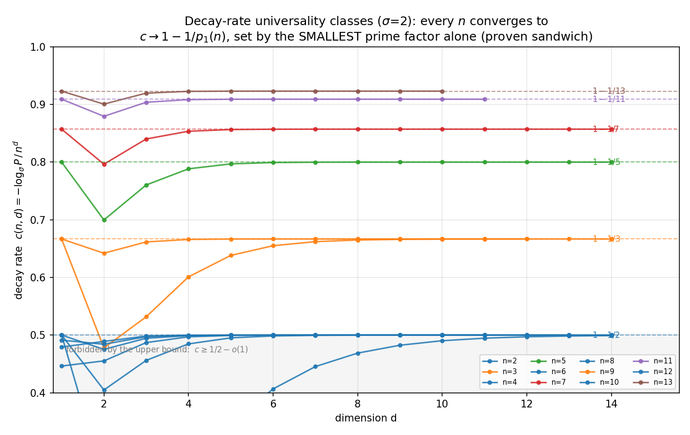
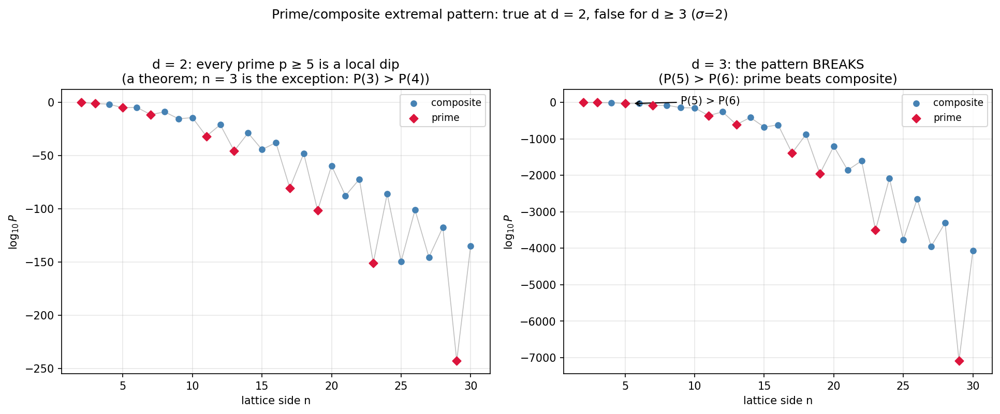
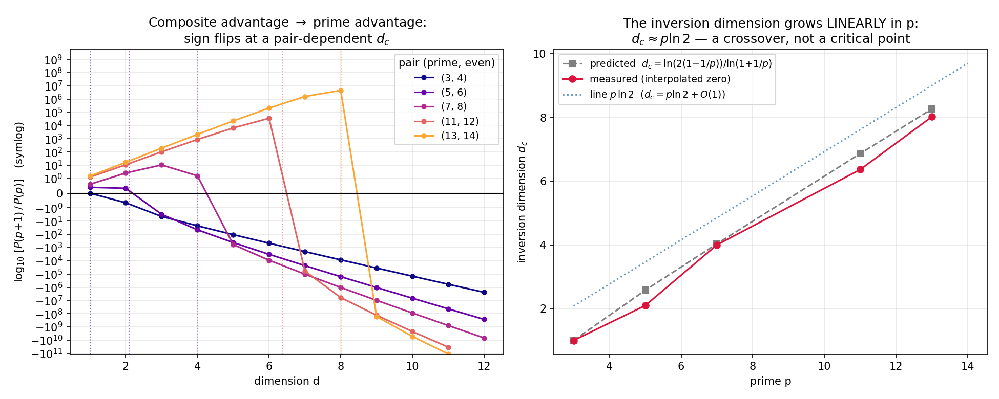
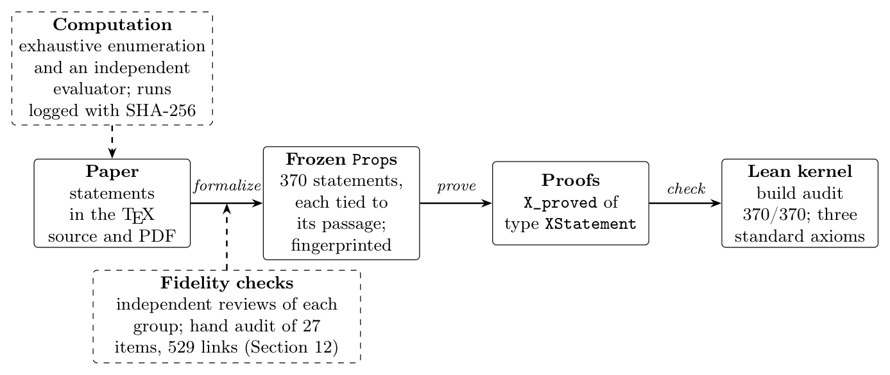

# Shift-Symmetric Configurations in d-Dimensional Cellular Automata

**Enumeration, Bounds, Irreversibility, and Detection**

Peter Banda (Cequence) · John Caughman (Portland State University) · Tobi Lehman (Functorial, Inc.) · 2026

[](LICENSE)
[](research/formal/shiftsym/)
[](https://arxiv.org/abs/2611.15751)
[](https://arxiv.org/pdf/2611.15751)

<p align="center">
  
</p>
<p align="center"><sub><b>Figure 1.</b> Configurations with σ = 2 symbols; an arrow runs from a cell u to u + v for a
generator v of the stabilizer. (a)–(b) shift-symmetric on ℤ₆², (c) not shift-symmetric, (d) shift-symmetric on ℤ₄³.
Of the 2³⁶ configurations on ℤ₆², exactly 801 064 are shift-symmetric.</sub></p>

A configuration of a cellular automaton on the torus $`\mathbb{Z}_n^d`$ is **shift-symmetric** if some nonzero
translation leaves it unchanged. Banda, Caughman, Cenek, and Teuscher (*Chaos* 29, 063120, 2019) counted these
configurations in two dimensions; this paper does it in every dimension, bounds their probability, shows that
translation-equivariant dynamics can never destroy a symmetry, and gives a fast detection algorithm. **The mathematical
content of every numbered statement is machine-checked in Lean 4**, and the correspondence between each theorem and its
formal statement was audited by hand.

This repository holds the paper ([arXiv:2611.15751](https://arxiv.org/abs/2611.15751)) and its supplementary material: the scripts behind
every enumeration, scan, and figure, the Lean development, and the correspondence audit.

The arXiv version is v1 of 11 November 2026 (math.CO, cross-listed in math.DS); the source and PDF here
(`shift_symmetry_d_dimensions.tex`, `.pdf`) are the same version.

## Main results

Notation: alphabet size $`\sigma`$, $`N = n^d`$ cells, $`S_{n^d}`$ the set of shift-symmetric configurations,
$`P^{\mathrm{unif}}_{n^d} = |S_{n^d}|/\sigma^N`$, $`p_1`$ the smallest prime factor of $`n`$, and
$`r_d(p,v) = p^{\binom v2}\binom{d}{v}_p`$ (Gaussian binomial): the Möbius numbers of the subspace lattice of
$`\mathbb{F}_p^d`$ weighted by Gaussian binomials.

**1. Exact enumeration in every dimension** (Theorem 4.4). For $`n = p_1^{a_1}\cdots p_k^{a_k}`$ and all
$`n \ge 2`$, $`d \ge 1`$, $`\sigma \ge 1`$:

```math
|S_{n^d}| \;=\; \sum_{\mathbf v \in \{0,\dots,d\}^k,\ \mathbf v \neq \mathbf 0} (-1)^{1+|\mathbf v|}\,
\prod_{i=1}^{k} r_d(p_i, v_i)\; \sigma^{\,n^d \prod_i p_i^{-v_i}} .
```

For a prime side $`n = p`$ this is (Corollary 4.5)

```math
|S_{p^d}| \;=\; \sum_{r=1}^{d} (-1)^{r+1}\, p^{\binom r2} \binom{d}{r}_{p}\, \sigma^{\,p^{d-r}},
\qquad\text{e.g.}\quad |S_{p^2}| = (p+1)\,\sigma^{p} - p\,\sigma .
```

Theorem 5.1 counts the shift-symmetric configurations with a prescribed number of active cells.

**2. Bounds: a lower bound attained exactly at the primes** (Theorems 6.1, 6.3, Corollary 7.1). For $`\sigma \ge 2`$:

```math
F_d(n,\sigma) := \sum_{r=1}^{d} (-1)^{r+1}\, n^{\binom r2} \binom{d}{r}_{n}\, \sigma^{\,n^{d-r}}
\;\le\; |S_{n^d}| \;\le\; \bigl(2^d - 1 + 2\log_2 n\bigr)\, \sigma^{\,n^d/2},
```

with equality on the left **if and only if $`n`$ is prime**.

**3. Decay-rate law: only the smallest prime factor survives** (Proposition 10.1).
$`\sigma^{N/p_1} \le |S_{n^d}| \le 2\log_2(n)\, n^{d-1} \sigma^{N/p_1}`$, so the decay rate
$`c(n,d) = -\log_\sigma P^{\mathrm{unif}}_{n^d}/N`$ tends to $`1 - 1/p_1(n)`$ as $`d \to \infty`$. Lattice sides fall into
universality classes set by their smallest prime factor alone; even $`n`$ form the extremal class $`c = 1/2`$.

<p align="center"></p>
<p align="center"><sub><b>Figure 3.</b> The decay rate converges to 1 − 1/p₁(n) (σ = 2).</sub></p>

**4. Inversion law: the composite advantage flips** (Proposition 10.2, Observation 7.3). In two dimensions an even side is
more likely to be symmetric than the prime below it: $`P^{\mathrm{unif}}_{(p+1)^2} \gt  P^{\mathrm{unif}}_{p^2}`$ for every prime
$`5 \le p \le 40`$ (exact computation; not for $`p = 3`$). This "composite advantage" inverts as the dimension grows: for
every prime $`p \ge 3`$ the crossover dimension is

```math
d_c(p) \;=\; \frac{\ln\bigl(2 - \tfrac{2}{p}\bigr)}{\ln\bigl(1 + \tfrac{1}{p}\bigr)} \;=\; p \ln 2 + O(1),
```

linear in the prime, with an explicit window: $`P^{\mathrm{unif}}_{(p+1)^d} \gt  P^{\mathrm{unif}}_{p^d}`$ for every
$`d \le d_c(p) - 20`$ and the reverse for every $`d \ge d_c(p) + 20`$. The two-dimensional pattern of $`P^{\mathrm{unif}}`$
(local minima at every prime $`5 \le n \le 40`$, maxima at every even $`4 \lt  n \le 40`$, by exact computation) breaks at
every $`d \ge 3`$ ($`\sigma = 2`$).

<p align="center"></p>
<p align="center"><sub><b>Figure 2.</b> The prime-dip / even-peak pattern holds at d = 2 and breaks at d = 3 (σ = 2).</sub></p>

<p align="center"></p>
<p align="center"><sub><b>Figure 4.</b> The sign of log[P(p+1)/P(p)] flips at d_c(p) ≈ p ln 2.</sub></p>

**5. Irreversibility and insolvability** (Theorem 8.1, Corollary 8.2, Proposition 8.3). For every
translation-equivariant map $`\Phi`$ (every cellular automaton), $`\mathrm{Stab}(\Phi(s)) \supseteq \mathrm{Stab}(s)`$:
symmetry can be gained but never lost, and every per-prime rank of the stabilizer is non-decreasing along every
trajectory. Hence no translation-equivariant cellular automaton solves leader election on $`\mathbb{Z}_n^d`$
($`\sigma \ge 2`$, $`N \gt  1`$), nor any task whose required output breaks a symmetry of some admissible input.

**6. Detection** (Theorem 9.1, Proposition 9.2). Shift symmetry is decided by reading at most
$`N \cdot \mathrm{sopf}_d(n)`$ cells, where $`\mathrm{sopf}_d(n) = \sum_{p \mid n} \binom{d}{1}_p`$ is the number of
cyclic subgroups of prime order; on a uniformly random input the expected number of reads is at most
$`2 \sum_{p \mid n} p \binom{d}{1}_p = O\bigl(\sum_{p \mid n} p^d\bigr)`$.

**7. Formal verification** (Sections 11–12). The two main theorems are proved in Lean 4 + mathlib in full generality,
and the mathematical content of every other numbered statement is frozen as one of 370 `Prop`s, each with a proof of
exactly its type, using only the three standard axioms. Whether each frozen statement says what the paper says was
checked by independent fidelity reviews and, for all 27 theorems, lemmas, propositions, and corollaries, by a hand
audit with a purpose-built paper–Lean viewer.

<p align="center"></p>
<p align="center"><sub><b>Figure 5.</b> The verification pipeline.</sub></p>

The paper (Section 12) also discusses applications: distributed computing, equivariant neural networks and neural
cellular automata, super-periodic structures in materials science, symmetric initial data in lattice simulations, and
random initial states.

### Reference values ($`\sigma = 2`$)

| torus | $`\mathbb{Z}_2^2`$ | $`\mathbb{Z}_3^2`$ | $`\mathbb{Z}_4^2`$ | $`\mathbb{Z}_5^2`$ | $`\mathbb{Z}_6^2`$ | $`\mathbb{Z}_2^3`$ | $`\mathbb{Z}_3^3`$ | $`\mathbb{Z}_2^4`$ |
| --- | --- | --- | --- | --- | --- | --- | --- | --- |
| $`\lvert S_{n^d}\rvert`$ | 8 | 26 | 736 | 182 | 801 064 | 72 | 6 398 | 3 072 |
| of all | $`2^4`$ | $`2^9`$ | $`2^{16}`$ | $`2^{25}`$ | $`2^{36}`$ | $`2^8`$ | $`2^{27}`$ | $`2^{16}`$ |

## Repository contents

| Path | Contents | Paper |
| --- | --- | --- |
| `shift_symmetry_d_dimensions.tex/.pdf` | The paper. | |
| `compute_charts.py`, `compute_criticality.py`, `compute_C_exploration.py`, `compute_dimension_insights.py`, `compute_example_configs.py` | Chart scripts: charts 1–16, and chart 17 = Figure 1 (example configurations, every stabilizer brute-force checked). Figures 2–4 are charts 14, 13 and 15. | §1, §10 |
| `charts/` | The generated charts (the exact formula evaluated in log space, cross-checked against exact integers; deterministic). | |
| `research/experiments/` | Verification scripts (`verify_*.py`: definition-level brute force, an independent subgroup-level evaluator, bounds, crossover laws, paper claims) with their outputs; `README.md` is the run log (commands, environments, seeds, SHA-256 checksums). | §1, §10 |
| `research/2d_fix_note/` | Erratum to Banda et al. (2019): corrects a misprint in its Eqs. (32)–(33) and the range of its Eqs. (30)–(33), states its standing assumptions, and repairs the proofs of its Lemmas E.21, A.21 and A.22; no figure or number of that paper changes. `verify_erratum.py` checks every claim. |
| `research/formal/shiftsym/` | The Lean 4 + mathlib development: core layer (`Definitions`, `Statement`, `Lemmas/`), paper-wide layer (`Paper/`: 370 frozen statements, one file per part of the paper, proofs in `Paper/Proofs/`), and the relative-enumeration module the paper's proofs use (`StatementE1`, `Lemmas/Relative`). | §11 |
| `research/formal/*.md`, `check_*.py`, `frozen_*`, `kernel_replay.lean` | Statement-preservation table (read it before trusting that a Lean name says what the paper says), formalization plan, the corrections the formalization found in earlier drafts, and the gates below. | §11 |
| `research/formal/main_paper_audit/` | Independent review of the formalization and the response to it. | §11 |
| `research/formal/correspondence_audit/` | The paper–Lean correspondence viewer and the audit log of all 27 theorems, lemmas, propositions and corollaries. | §12 |
| `docs/` | Figures 1 and 5 rendered for this page from the paper's PDFs. | |

## Reproducing the computations

Python 3 with `numpy`, `matplotlib`, `mpmath`, `sympy` (and `scipy` for
`compute_C_exploration.py`). Run the chart scripts from the repository root and the
verification scripts from `research/experiments/`. All counts and verification computations use
exact integers; the charts evaluate the exact formula in log space. The run log
(`research/experiments/README.md`) records commands, environments and SHA-256 checksums; the
chart scripts' output of the last full run is in `research/experiments/chart_outputs/`. The
reference values above are sanity anchors.

## Checking the Lean development

From `research/formal/shiftsym/` (toolchain pinned in `lean-toolchain`):

```
lake exe cache get                         # mathlib cache (about 8 GB)
lake build                                 # must end green; includes the audit module AuditPaper
lake env lean Shiftsym/Audit.lean          # axiom set of each listed theorem
python3 ../check_placeholders.py           # must print CLEAN
python3 ../check_frozen.py                 # frozen statements and their definition files unchanged
lake env lean ../frozen_deps.lean          # every file a statement unfolds to is fingerprinted
lake env lean ../kernel_replay.lean        # optional: full kernel replay; fails unless errors=0
```

Axioms: only `propext`, `Classical.choice`, `Quot.sound`; no `sorry`, no `native_decide`.

## The correspondence audit

```
python3 research/formal/correspondence_audit/serve.py      # then open http://127.0.0.1:8765/
```

The viewer loads PDF.js and KaTeX from a CDN, so it needs an internet connection. Opening it
appends your session to `logs/events.jsonl` (`git checkout research/formal/correspondence_audit/logs`
discards it). See `research/formal/correspondence_audit/README.md`. A product version of the viewer is in
development at <https://functorial.inc/>.

## Scope of this release

The authors' working repository also contains follow-up research that is not part of this
paper (further papers with their own Lean packages, and experiments); it is omitted here. The
Lean development `research/formal/shiftsym/` is the working repository's, file for file, except
for the unused template `Basic.lean`; it includes `Shiftsym/StatementE1.lean` (the relative
enumeration theorem), which the paper's proofs use. These files differ from the working repository:

- the viewer data (`correspondence_audit/data/audit_data.json`) lists no omitted module and no
  absolute path of the working tree;
- the run log, the statement-preservation table and the formalization plan carry a note where a
  section about the omitted work was removed; in the review records, links to absolute paths of
  the working tree are rewritten as repository links, and files that are not exported are noted.

Scientific records retain their verification results; internal editorial discussions and repository-access decisions are omitted from the release. Some of them, and some comments and frozen docstrings
(which cannot change without invalidating their fingerprints), name files of the working
repository that are not published here (`scratchpad/…`, `research/claims.yaml`,
`research/proofs/…`, `problem.md`, `FOLLOW_UPS.md`, `research/paper_edits/…`). Commit
identifiers in the records refer to the working repository.

## How to cite

```bibtex
@misc{banda2026shiftsymmetric,
  title         = {Shift-Symmetric Configurations in $d$-Dimensional Cellular Automata:
                   Enumeration, Bounds, Irreversibility, and Detection},
  author        = {Banda, Peter and Caughman, John and Lehman, Tobi},
  year          = {2026},
  eprint        = {2611.15751},
  archivePrefix = {arXiv},
  primaryClass  = {math.CO},
  url           = {https://arxiv.org/abs/2611.15751}
}
```

## License

MIT; see `LICENSE`.
